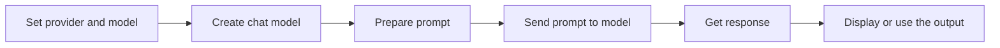

# Lesson 01: Basics of Models in LangChain

## What this lesson is teaching

Lesson 01 is the starting point for understanding how large language models are used inside a real application. The main idea is simple: we do not call an AI model in a random or magical way. We define which model we want to use, pass a prompt to it, and receive a response back.

This lesson helps you understand the basic building blocks of an LLM-powered app:

- choosing a provider such as OpenAI, Google, or Anthropic
- choosing a model such as a small or large chat model
- setting the model configuration in one place
- sending a user prompt and reading the response

The goal is to make the flow feel natural and predictable, instead of treating AI as a black box.

## The big picture

At the heart of this lesson is a simple pattern:

1. You tell the application which model provider to use.
2. You tell it which model to call.
3. You create a chat model object with those settings.
4. You send a prompt.
5. The model returns a response.

This is the foundation for every future lesson. Once this pattern feels clear, the rest of LangChain becomes much easier to understand.

## Flow of the lesson

In human terms, this is the same as saying:

- decide which AI service to use
- decide which model to ask
- ask a question or give a task
- read the answer
- then decide what to do with it next

## Why this matters

This is important because almost everything else in LangChain builds on this basic flow. If you do not understand how a model is selected and called, it becomes hard to debug issues later.

A few common reasons this matters:

- You may want to switch between providers without rewriting your application.
- You may need to change the model for cost, speed, or quality reasons.
- You may want to test different prompts and compare results.
- You may need to understand why a model is returning a different answer than expected.

In short, Lesson 01 teaches the foundation of model usage. Everything else, such as memory, tools, prompt engineering, chains, and agents, sits on top of this understanding.

## Why this feels like the real start of LLM apps

Many people imagine an AI app as just “send text and get text back.” That is true at a high level, but the real power comes from designing a clean pipeline:

- configuration is separated from logic
- prompts are easy to adjust
- model choice can be changed without major rewrites
- responses can be used in business logic, chat interfaces, or automation workflows

This lesson introduces that mindset.

## Key takeaway

Lesson 01 is not about memorizing syntax. It is about understanding the mental model behind calling a language model in a structured way.

The real lesson is this:

A LangChain app is simply a system that chooses a model, sends a prompt, and turns the model response into useful output.

Once this basic idea is clear, every more advanced topic becomes much easier to learn.